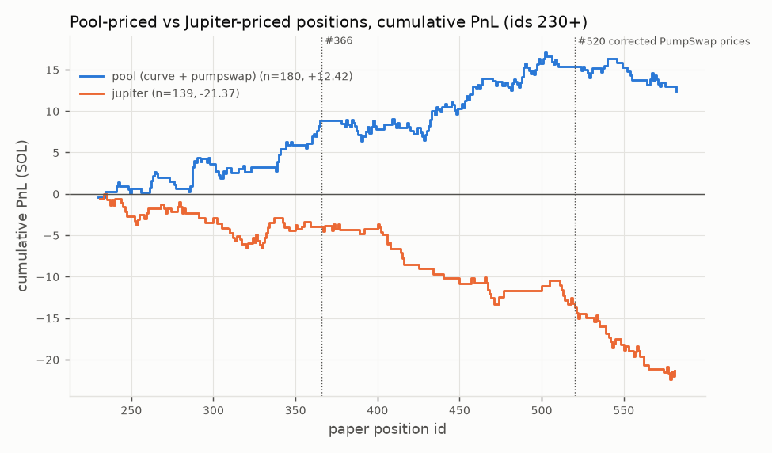
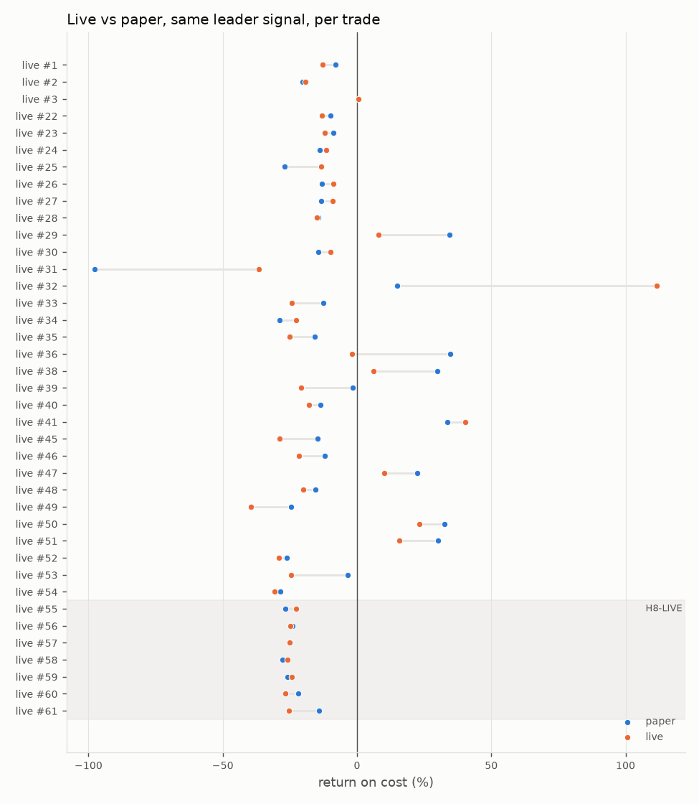
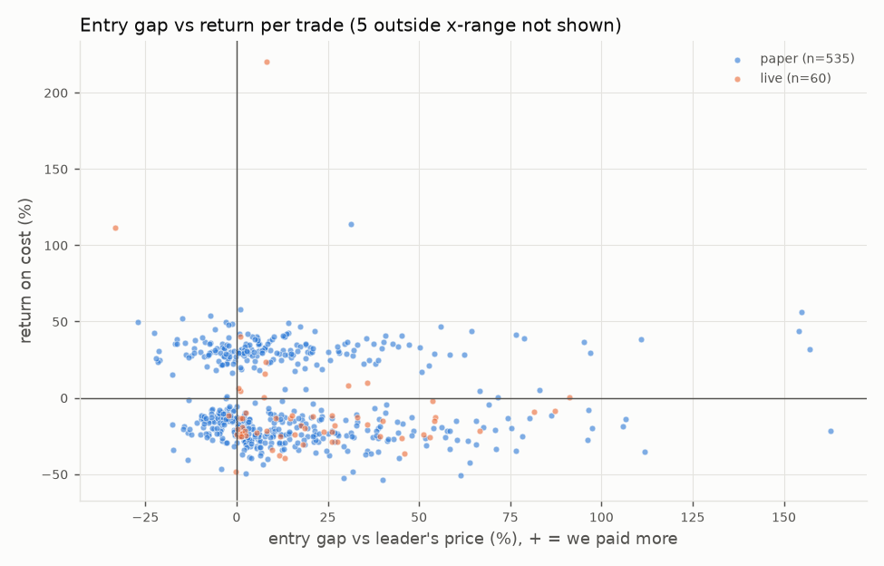
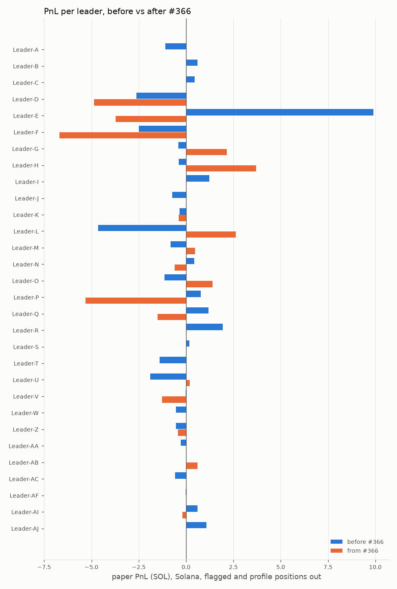
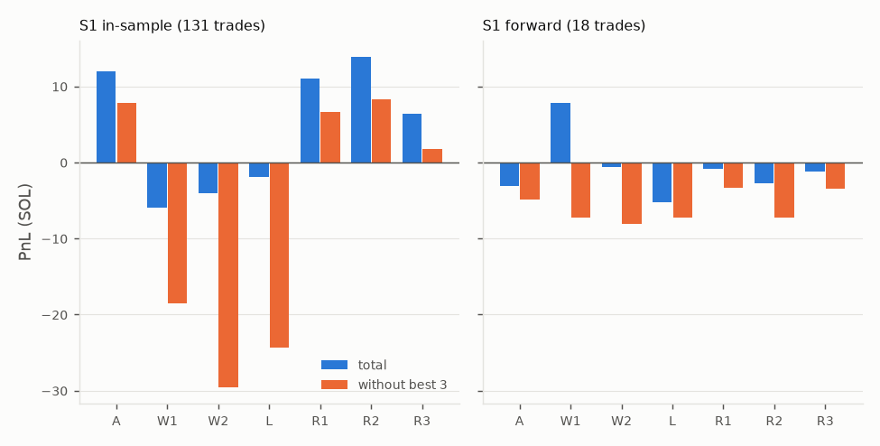

# Results

Generated by `scripts/export_results.py` from the paper (dev) and live databases, read-only. Facts and definitions only.

Data: paper positions opened 2026-10-02 to 2026-10-12 (UTC dates), live positions 2026-10-05 to 2026-10-09.
Per-position data: [`positions_paper.csv`](positions_paper.csv), [`positions_live.csv`](positions_live.csv).

## Definitions and filters

- **Period**: before / after paper position #366 (restart of 2026-10-08). Live positions carry their own ids, so they are placed by opening time against the opening time of paper #366.
- **Venue class**: `curve` = pump.fun bonding curve, `pumpswap` = PumpSwap AMM, `jupiter` = priced by Jupiter quotes, `vault` = Meteora (vault balances x Jupiter factor), `evm` = Robinhood / BSC, `unknown` = no venue logged at the fill. *pool* = curve + pumpswap.
- **Entry gap**: our fill price (cost / tokens, all-in) vs the leader's price in the swap we copied, in % (+ = we paid more). EVM: median of the position's buy-fill gaps.
- **Entry market cap bucket** (USD at the fill, as logged by the bot): <30k, 30-100k, 100-250k, 250-500k, >=500k, n/a.
- **Flagged** (CSV column `flagged`, `flag_reason`): excluded from every table and chart (closed positions flagged: paper 9 (bot_flag 1, downtime 1, mark_step 7), live 1 (mark_step 1)). `mark_step` = single-step mark change > 50% not confirmed by an independent price; `bot_flag` = flagged by the bot itself; `downtime` = open while the dev bot was down (2026-10-10 20:35 to 2026-10-11 12:41 UTC, exits not monitored).
- **Profile positions** (`profile` = yes) were opened under a per-leader profile with their own exit rules; excluded from the Solana tables, kept in the CSV.
- Solana PnL is in SOL; EVM PnL in USD. The tables below use closed Solana paper positions that are not flagged and not profile positions, unless a heading says otherwise.
- PumpSwap prices include `virtual_quote_reserves` in the dev pool model from position #520 on. Paper positions before that were priced and filled on the vault-only model. The exit-arm replays and the runner anatomy re-price every PumpSwap tick on vault + reconstructed virtual reserves ("corrected prices"); the CSV and the H5 / leader tables are the results as recorded.

## H5: venue split, pool vs Jupiter (paper, from #230)

| ids | class | n | wins | PnL SOL | w/o best 3 | avg % | median % | stop fill median |
| :--- | :--- | ---: | ---: | ---: | ---: | ---: | ---: | ---: |
| #230+ | pool (curve + pumpswap) | 180 | 85/180 | +12.42 | +7.88 | +3.4% | -11.9% | -23.0% (n=94) |
| #230+ | curve | 35 | 18/35 | +5.11 | +1.01 | +7.3% | +16.9% | -24.7% (n=17) |
| #230+ | pumpswap | 145 | 67/145 | +7.31 | +4.02 | +2.5% | -11.9% | -22.4% (n=77) |
| #230+ | jupiter | 139 | 50/139 | -21.37 | -24.07 | -7.6% | -24.8% | -28.5% (n=90) |
| #230-365 | pool (curve + pumpswap) | 57 | 30/57 | +8.85 | +4.54 | +7.7% | +19.5% | -21.0% (n=26) |
| #230-365 | curve | 12 | 10/12 | +7.29 | +3.24 | +30.2% | +33.5% | -22.7% (n=2) |
| #230-365 | pumpswap | 45 | 20/45 | +1.56 | -1.26 | +1.7% | -11.8% | -20.7% (n=24) |
| #230-365 | jupiter | 64 | 27/64 | -3.98 | -6.35 | -3.1% | -21.9% | -27.5% (n=38) |
| #366+ | pool (curve + pumpswap) | 123 | 55/123 | +3.58 | +0.41 | +1.4% | -14.1% | -23.4% (n=68) |
| #366+ | curve | 23 | 8/23 | -2.18 | -4.51 | -4.7% | -21.9% | -24.9% (n=15) |
| #366+ | pumpswap | 100 | 47/100 | +5.75 | +2.58 | +2.9% | -12.8% | -23.0% (n=53) |
| #366+ | jupiter | 75 | 23/75 | -17.38 | -20.02 | -11.5% | -26.0% | -30.1% (n=52) |

## H8-LIVE: live vs paper

| H8-LIVE (live ids 55+) | value |
| :--- | ---: |
| live positions (closed) | 7 |
| matched with a paper position | 7 |
| exits by stop_loss (live) | 7/7 |
| realized PnL live (SOL) | -1.751 |
| buys that failed on the slippage limit | 0 (vs 7 filled) |
| realized buy slippage vs Jupiter quote, median | -1.3% (n=7) |
| fill price live vs paper, median / mean | -3.9% / -0.1% |
| entry gap vs leader, live, median | +39.3% (n=7) |
| stop fill live minus paper, common stops | -1.4 points (n=7) |
| position size, median (SOL): live / paper | 1.00 / 2.01 |

| live id | date | leader | venue | fill live vs paper | buy slip | gap live | gap paper | live exit | paper exit | points |
| ---: | :--- | :--- | :--- | ---: | ---: | ---: | ---: | ---: | ---: | ---: |
| 55 | 2026-10-08 | Leader-E | pumpswap | +9.7% | +0.0% | +5.4% | -3.9% | stop_loss -22.7% | stop_loss -26.7% | +4.0 |
| 56 | 2026-10-08 | Leader-E | pumpswap | +12.5% | -3.4% | +1.2% | -10.0% | stop_loss -25.0% | stop_loss -24.1% | -0.9 |
| 57 | 2026-10-09 | Leader-E | curve | -5.8% | +10.4% | +39.3% | +48.0% | stop_loss -25.1% | stop_loss -24.9% | -0.2 |
| 58 | 2026-10-09 | Leader-E | curve | -4.8% | -1.3% | +52.9% | +60.4% | stop_loss -25.8% | stop_loss -27.7% | +1.8 |
| 59 | 2026-10-09 | Leader-E | curve | -3.9% | -2.0% | +51.1% | +57.1% | stop_loss -24.3% | stop_loss -25.8% | +1.5 |
| 60 | 2026-10-09 | Leader-E | curve | -8.2% | +1.6% | +45.3% | +58.3% | stop_loss -26.7% | stop_loss -21.9% | -4.8 |
| 61 | 2026-10-09 | Leader-E | curve | -0.1% | -13.1% | +11.9% | +11.9% | stop_loss -25.3% | stop_loss -14.1% | -11.2 |

Entry gap and per-trade return, all Solana positions with a logged leader price:

## Leaders, before vs after #366 (paper)

| leader (before #366 \| after #366) | n | PnL SOL | w/o best | avg % | n | PnL SOL | w/o best | avg % |
| :--- | ---: | ---: | ---: | ---: | ---: | ---: | ---: | ---: |
| Leader-A | 8 | -1.10 | -1.97 | -6.8% | 0 | - | - | - |
| Leader-B | 1 | +0.60 | - | +30.0% | 0 | - | - | - |
| Leader-C | 20 | +0.46 | -0.42 | +1.1% | 0 | - | - | - |
| Leader-D | 20 | -2.63 | -3.36 | -6.5% | 22 | -4.86 | -5.66 | -11.0% |
| Leader-E | 28 | +9.90 | +7.61 | +17.6% | 20 | -3.73 | -4.54 | -9.3% |
| Leader-F | 13 | -2.50 | -3.31 | -9.5% | 16 | -6.68 | -7.46 | -20.8% |
| Leader-G | 36 | -0.41 | -1.25 | -0.6% | 32 | +2.15 | +1.17 | +3.4% |
| Leader-H | 18 | -0.38 | -1.10 | -0.1% | 13 | +3.70 | +2.66 | +14.2% |
| Leader-I | 4 | +1.22 | +0.09 | +15.2% | 0 | - | - | - |
| Leader-J | 3 | -0.74 | -0.69 | -12.2% | 0 | - | - | - |
| Leader-K | 13 | -0.34 | -1.00 | -0.3% | 3 | -0.37 | -0.95 | -6.2% |
| Leader-L | 13 | -4.64 | -5.37 | -17.8% | 17 | +2.62 | +1.74 | +7.7% |
| Leader-M | 4 | -0.82 | -1.75 | -6.8% | 3 | +0.48 | -0.14 | +8.0% |
| Leader-N | 4 | +0.43 | -0.21 | +5.4% | 3 | -0.59 | -1.19 | -9.8% |
| Leader-O | 9 | -1.13 | -1.97 | -6.2% | 3 | +1.41 | +0.84 | +23.4% |
| Leader-P | 7 | +0.78 | +0.11 | +5.5% | 22 | -5.32 | -5.95 | -12.0% |
| Leader-Q | 31 | +1.19 | +0.11 | +1.9% | 9 | -1.51 | -2.22 | -8.3% |
| Leader-R | 3 | +1.94 | +1.15 | +32.1% | 0 | - | - | - |
| Leader-S | 3 | +0.18 | -0.59 | +2.9% | 0 | - | - | - |
| Leader-T | 18 | -1.39 | -2.06 | -3.9% | 0 | - | - | - |
| Leader-U | 22 | -1.88 | -2.61 | -4.3% | 2 | +0.20 | -0.35 | +4.8% |
| Leader-V | 2 | -0.02 | -0.40 | -0.4% | 6 | -1.27 | -1.90 | -10.5% |
| Leader-W | 2 | -0.55 | -0.29 | -13.6% | 0 | - | - | - |
| Leader-Z | 1 | -0.54 | - | -26.9% | 1 | -0.44 | - | -21.8% |
| Leader-AA | 2 | -0.27 | -0.24 | -6.7% | 0 | - | - | - |
| Leader-AB | 0 | - | - | - | 1 | +0.59 | - | +29.6% |
| Leader-AC | 2 | -0.59 | -0.32 | -14.7% | 0 | - | - | - |
| Leader-AF | 3 | -0.03 | -0.64 | -0.5% | 0 | - | - | - |
| Leader-AI | 25 | +0.61 | -0.37 | +1.2% | 25 | -0.19 | -1.36 | -0.4% |
| Leader-AJ | 27 | +1.08 | +0.09 | +2.0% | 0 | - | - | - |
| **all leaders** | 342 | -1.56 | -3.85 | -0.1% | 198 | -13.81 | -14.98 | -3.5% |

All leaders without the best 3 trades: before: -6.06 SOL; after: -17.00 SOL. `w/o best` = PnL without that leader's best trade.

## EVM positions (paper, USD, profile positions out)

| chain | vs #366 | n | wins | PnL USD | w/o best | median % |
| :--- | :--- | ---: | ---: | ---: | ---: | ---: |
| robinhood | before | 6 | 1/6 | -580 | -765 | -21.1% |
| robinhood | after | 1 | 0/1 | -53 | - | -29.3% |
| bsc | before | 7 | 2/7 | +291 | -265 | -33.3% |
| bsc | after | 3 | 0/3 | -205 | -162 | -37.5% |

## Exit arms on corrected prices (what-if replays on recorded ticks)

Pool-priced S1 trades (all Solana leaders except Leader-D, Leader-F, Leader-O, Leader-M); S2 = Leader-G, Leader-E, Leader-H. Fills on the first tick at or after the trigger + the paper landing delay, on the shadow pool (our own buy added), pool fee + paper fee per sell, stop basis entry price. Censored = the data ended while still holding; never counted as a win or a loss.

**S1, in-sample** (ids 230-519; 131 replayable trades; designed on these trades: not evidence)

| arm | n | total SOL | w/o best 1 | w/o best 3 | wins | median | max DD | censored (mark SOL) |
| :--- | ---: | ---: | ---: | ---: | ---: | ---: | ---: | ---: |
| A | 126 | +12.03 | +9.89 | +7.82 | 63/126 | +7.3% | -3.60 | 5 (+0.59) |
| W1 | 119 | -6.00 | -10.30 | -18.54 | 11/119 | -21.2% | -22.26 | 12 (+7.51) |
| W2 | 118 | -3.99 | -13.39 | -29.57 | 6/118 | -21.2% | -21.16 | 13 (+12.89) |
| L | 120 | -1.89 | -9.76 | -24.40 | 23/120 | -20.7% | -14.51 | 11 (+7.85) |
| R1 | 126 | +11.01 | +8.88 | +6.67 | 64/126 | +7.3% | -3.20 | 5 (+0.64) |
| R2 | 124 | +13.89 | +11.61 | +8.30 | 49/124 | -16.9% | -4.35 | 7 (+2.13) |
| R3 | 123 | +6.44 | +4.55 | +1.71 | 61/123 | -0.4% | -4.71 | 8 (+2.63) |

**S2, in-sample** (ids 230-519; 59 replayable trades; designed on these trades: not evidence)

| arm | n | total SOL | w/o best 1 | w/o best 3 | wins | median | max DD | censored (mark SOL) |
| :--- | ---: | ---: | ---: | ---: | ---: | ---: | ---: | ---: |
| A | 54 | +7.10 | +4.96 | +3.16 | 29/54 | +21.6% | -4.06 | 5 (+0.59) |
| W1 | 52 | +0.33 | -3.98 | -12.01 | 6/52 | -23.7% | -13.05 | 7 (+3.66) |
| W2 | 52 | +8.19 | -1.21 | -17.39 | 4/52 | -23.7% | -13.46 | 7 (+3.66) |
| L | 52 | +13.61 | +5.74 | -8.89 | 13/52 | -22.1% | -9.30 | 7 (+3.63) |
| R1 | 54 | +6.06 | +3.93 | +1.75 | 29/54 | +13.3% | -4.11 | 5 (+0.64) |
| R2 | 53 | +7.67 | +5.39 | +2.08 | 22/53 | -20.6% | -4.47 | 6 (+1.90) |
| R3 | 54 | +4.91 | +3.01 | +0.50 | 29/54 | +13.3% | -4.23 | 5 (+0.64) |

**S1, forward** (ids 520+; 18 replayable trades; trades after the arms were registered (H11))

| arm | n | total SOL | w/o best 1 | w/o best 3 | wins | median | max DD | censored (mark SOL) |
| :--- | ---: | ---: | ---: | ---: | ---: | ---: | ---: | ---: |
| A | 17 | -3.07 | -3.89 | -4.90 | 5/17 | -20.2% | -3.11 | 1 (-0.14) |
| W1 | 17 | +7.88 | +1.19 | -7.23 | 3/17 | -22.7% | -2.90 | 1 (-0.14) |
| W2 | 17 | -0.56 | -8.42 | -8.14 | 1/17 | -23.5% | -8.02 | 1 (-0.14) |
| L | 16 | -5.27 | -6.74 | -7.22 | 2/16 | -22.7% | -5.27 | 2 (+5.00) |
| R1 | 17 | -0.80 | -2.17 | -3.33 | 7/17 | -19.7% | -1.60 | 1 (-0.13) |
| R2 | 17 | -2.77 | -5.39 | -7.23 | 3/17 | -22.7% | -3.15 | 1 (-0.13) |
| R3 | 17 | -1.17 | -2.37 | -3.42 | 7/17 | -19.7% | -1.64 | 1 (-0.13) |

**S2, forward** (ids 520+; 13 replayable trades; trades after the arms were registered (H11))

| arm | n | total SOL | w/o best 1 | w/o best 3 | wins | median | max DD | censored (mark SOL) |
| :--- | ---: | ---: | ---: | ---: | ---: | ---: | ---: | ---: |
| A | 12 | -1.01 | -1.84 | -2.85 | 5/12 | -13.6% | -1.54 | 1 (-0.14) |
| W1 | 12 | +9.94 | +3.25 | -5.18 | 3/12 | -23.5% | -2.87 | 1 (-0.14) |
| W2 | 12 | +1.49 | -6.37 | -6.08 | 1/12 | -25.7% | -6.37 | 1 (-0.14) |
| L | 11 | -3.22 | -4.69 | -5.17 | 2/11 | -25.6% | -3.22 | 2 (+5.00) |
| R1 | 12 | +1.25 | -0.12 | -1.28 | 7/12 | +17.5% | -1.06 | 1 (-0.13) |
| R2 | 12 | -0.72 | -3.33 | -5.18 | 3/12 | -23.5% | -2.87 | 1 (-0.13) |
| R3 | 12 | +0.88 | -0.32 | -1.37 | 7/12 | +16.7% | -1.06 | 1 (-0.13) |

- `A` = TP +30% / SL -20% (current bot)
- `W1` = TP +200% / SL -20%
- `W2` = TP +400% / SL -20%
- `L` = 25% at +100/+200/+400/+800%, stop -20% until the first fill, then stop at entry
- `R1` = 75% at +30%, stop -20% until then; remainder: stop at 0.8x entry, 12.5% at 3x, 12.5% at 5x, trail 20% from 3x, max 24 h
- `R2` = 50% at +50%, stop -20% until then; remainder: stop at entry, 25% at 3x, 25% at 5x, trail 20% from 3x, max 24 h
- `R3` = 75% at +30%, stop -20% until then; remainder: stop at entry, 12.5% at 2x, 12.5% at 3x

## Runner anatomy (S1, ids 230+, corrected prices)

| peak multiple of our entry (24 h) | trades | share | 95% interval |
| :--- | ---: | ---: | ---: |
| 1.3x | 105/149 | 70% | 63-77% |
| 1.5x | 82/149 | 55% | 47-63% |
| 2x | 54/149 | 36% | 29-44% |
| 3x | 27/149 | 18% | 13-25% |
| 5x | 13/149 | 9% | 5-14% |
| 10x | 3/149 | 2% | 1-6% |

| measure | value |
| :--- | ---: |
| replayable trades (S1, ids 230+) | 149 |
| tick coverage after the fill, median | 6.1 h |
| trades with >= 24 h of ticks | 31/149 |
| runners (>= 3x within 24 h) | 27/149 |
| runners: time to 1.3x / 2x / 3x, median | 42 s / 8 min / 26 min |
| runners: time to the peak, median | 62 min |
| runners: pullback from the running high before the peak, median | -61% |
| runners: share with a > 30% / > 50% pullback before the peak | 23/27 / 18/27 |
| runners: time until 30% / 50% of the gain is given back after the peak, median | 48 s / 6 min |
| non-runners: touched 1.3x | 78/122 |
| non-runners that touched 1.3x and later fell to <= 0.8x | 71/78 |
| non-runners: time to <= 0.8x, median | 115 s |
| non-runners: multiple at the end of the window, median | 0.26x |

## Files

- `positions_paper.csv`, `positions_live.csv`: columns `id`, `chain`, `opened_date`, `period`, `leader`, `venue`, `entry_mc_bucket`, `entry_gap_pct`, `pnl_pct`, `exit_reason`, `hold_s`, `flagged`, `flag_reason`, `profile`, `cost`, `pnl`, `unit`. Dates are UTC days; `hold_s` is the hold time in seconds; `cost` and `pnl` in `unit`.
- `tables/*.md`: the tables above. `charts/*.png`: the charts above.
